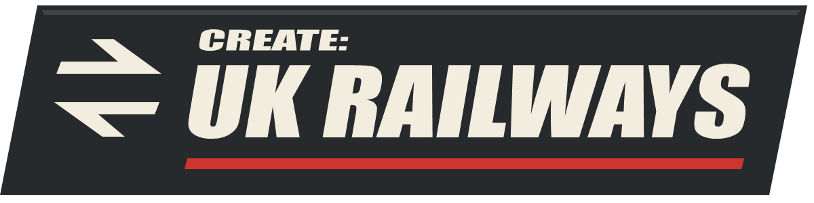
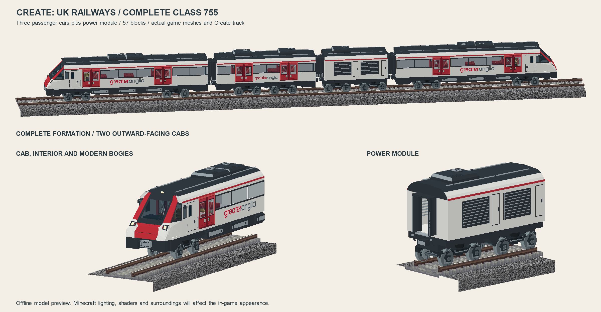

# Create: UK Railways

Build a British railway with Create: mainline signals, semaphores, shunts,
automatic crossings, concrete sleeper track, Greater Anglia train kits, stations,
passenger information, tickets, road signs and trackside equipment.

**Current download: 1.0.0-rc.3 (prerelease)**

## Download and install

1. [Download ukrailways-1.0.0-rc.3.jar](https://github.com/Red463/UKRailways/releases/download/v1.0.0-rc.3/ukrailways-1.0.0-rc.3.jar).
2. Use **Minecraft 1.21.1**, **Java 21**, **NeoForge 21.1.251** and **Create 6.0.10**
   with its normal dependencies. JEI is optional.
3. Put the same UK Railways JAR in the server and every client's `mods` folder.
   Remove older UK Railways JARs, back up your world, then restart.
4. Read [Installation](docs/Installation.md) and [Your first UK railway](docs/Getting-Started.md).

Use the **JAR under Releases → Assets**, not GitHub's automatic source archives.
Current HD artwork is bundled; no separate resource pack is required.
See [all releases](https://github.com/Red463/UKRailways/releases) and
[rc.3 release notes](docs/Release-Notes.md).

## Player guide

- [Full GitHub wiki](https://github.com/Red463/UKRailways/wiki)
- [Guide index in this repository](docs/Home.md)
- [Every block and item](docs/Block-and-Item-Catalogue.md)
- [Crafting and manufacturing recipes](docs/Crafting.md)
- [Troubleshooting](docs/Shader-and-Preview-Troubleshooting.md)

| Build | Guides |
| --- | --- |
| Working British signalling | [Signals](docs/Signals.md), [Semaphores](docs/Semaphores.md), [Shunts](docs/Ground-Shunts.md), [Speed limits](docs/Speed-Limits.md) |
| Track and infrastructure | [Concrete track](docs/UK-Concrete-Track.md), [Ballast](docs/Railway-Ballast.md), [Poles](docs/Poles.md), [Gantries](docs/Gantries.md), [Crossings](docs/Level-Crossings.md) |
| Greater Anglia Class 755 and 745 trains | [Kits](docs/Train-Kits.md), [Manufacturing](docs/Train-Manufacturing.md), [Air horn](docs/Train-Air-Horn.md), [Engineer workwear](docs/Engineer-Workwear.md) |
| Stations and passengers | [Construction](docs/Station-Construction.md), [Canopies](docs/Canopy-Building.md), [Signs](docs/Station-Signs.md), [Adverts](docs/Station-Adverts.md), [Tickets](docs/Tickets.md) |
| Railway information | [Displays](docs/Information-Displays.md), [Laptop](docs/Railway-Laptop.md), [Tablet](docs/Railway-Tablet.md), [Speakers](docs/Station-Speakers.md), [Optional web viewer](docs/Browser-Network-Viewer.md) |
| Roads and details | [Roadworks Workbench/signs](docs/Roadworks-Workbench-and-Signs.md), [Markings](docs/Road-Markings.md), [Palisades](docs/Palisade-Fencing.md), [Grit bin](docs/Grit-Bin.md), [Tunnel lights](docs/Tunnel-Lighting.md) |

## Important behaviour and compatibility

Keep original **Create track signals** installed: they control trains. UK signal
heads display linked authority. Train kits place vehicles; assemble them at a
Create station and use Create's normal conductor/schedule system.

rc.3 fixes repeated junction geometry rebuilding while a schematic preview is
visible. It includes rc.2's UK curve shader compatibility fix. Compatibility
rendering costs additional CPU work for UK curves with Colorwheel. Large previews
still have a rendering cost. These fixes do not establish compatibility with every
shader pack, schematic or modpack; full ATM10 multiplayer acceptance remains pending.

This repository contains player downloads and documentation. Development sources,
private configuration, test environments and development history are not published
here. Report reproducible problems through [Issues](https://github.com/Red463/UKRailways/issues)
and redact private information before attaching logs.

The mod declares **All Rights Reserved**; third-party material retains its own
terms and attribution. See [Notices](NOTICES.md).
