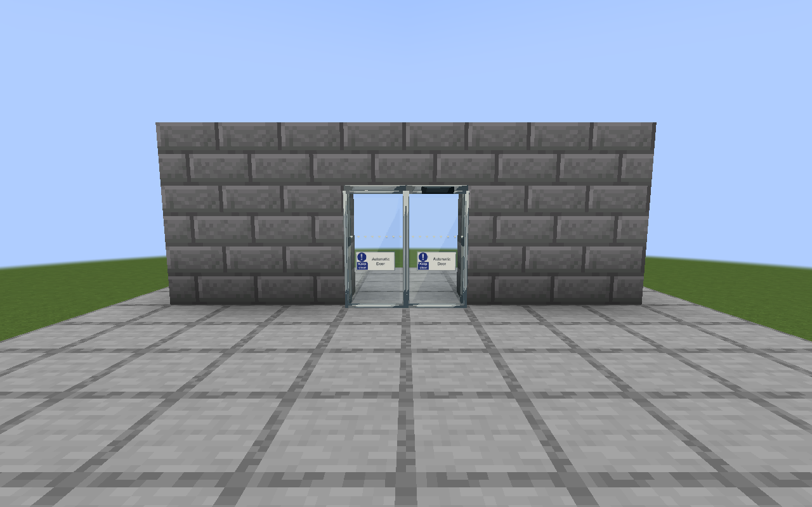
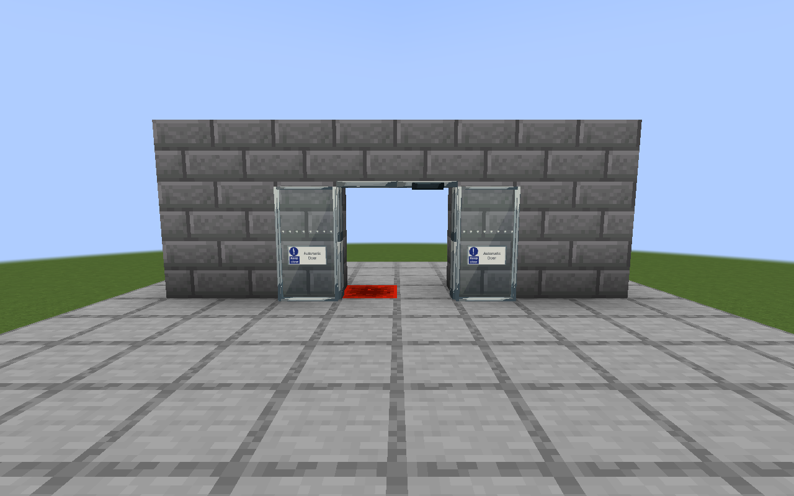

# Automatic sliding station doors

Build glass station entrances with silver frames, white visibility dots and white keep-clear / automatic-door stickers. These are stationary building doors; train kits retain their own carriage doors.

## Build an entrance

1. Place an **Automatic Sliding Door** on a solid floor with two clear blocks above it. One item creates one leaf, one block wide and two blocks tall.
2. For a double entrance, place a second leaf immediately alongside the first, facing the same direction. The second leaf chooses the opposite hand so the pair slides apart. A pair is limited to two leaves; nearby doors do not form an activation chain.
3. Leave a block of visible wall space outside each leaf for its sliding panel. The panel passes across the front of the wall; its decorative overhang does not add collision to neighbouring blocks.
4. Right-click either half with an **Automatic Door Sensor**. One sensor operates both leaves of a pair, from either side. Survival attachment consumes one sensor; an already fitted leaf cannot consume another.

Both items appear in the Create: UK Railways creative tab. Craft one door with `IGI/IGI/IPI`, where I is iron ingot, G is glass pane and P is piston. Craft one sensor with `IRI/RQR`, where I is iron ingot, R is redstone and Q is quartz.

## Automatic operation

An attached sensor detects living players within three blocks on either side of the doorway plane, across the entrance width plus half a block on either side, and up to three blocks above the floor. A clear sight line to a sensor is required: a player in an adjacent corridor behind a wall does not activate it. Creative players activate it; spectators, mobs, armour stands and items do not activate the approach sensor.

The entrance checks for approach every four game ticks. Opening and closing each take 12 ticks (0.6 seconds at 20 TPS). Doors remain open for 40 ticks (two seconds) after the last detected approach. Returning while they close reverses the movement smoothly.

A separate safety check runs every tick across the opening. A living occupant holds or reopens the entrance, including an animal already passing through. This protection works without a sensor while the entrance is open or moving. Occupancy alone cannot activate a fully closed door: fit a sensor or supply redstone power. Spectators and armour stands are ignored. Closed doors block walking; collision clears near the end of the opening movement, once the panels have moved aside.

Direct redstone power to either half of either leaf holds a paired entrance open. Removing power returns it to sensor, safety and closing-delay behaviour. A door without a sensor can be operated with redstone.

## Chime and pickup

Empty-hand right-click on either half of a sensor-equipped leaf toggles that leaf's chime and displays its setting. Newly installed sensors have their chime enabled. A pair plays one short ding when it begins opening from fully closed, provided at least one of its sensors is unmuted. Mute both sensors if both leaves have one. Holding open, reversing partway, loading chunks and joining clients do not repeat the ding. The sound uses Minecraft's **Blocks** volume slider.

Normal Create wrench use rotates a standalone leaf, including both halves. Separate paired leaves before rotating. Sneak-use the wrench on either half to recover the complete leaf and its sensor as separate items. Survival breaking of either half also returns one door and one fitted sensor. Its neighbour remains in place. Creative breaking returns no items. Pistons cannot move the doors.

Sensor and chime settings survive world saves. Pairing is derived from the current arrangement of loaded doors and is refreshed after placement, removal and loading; sensors never force neighbouring chunks to load.

